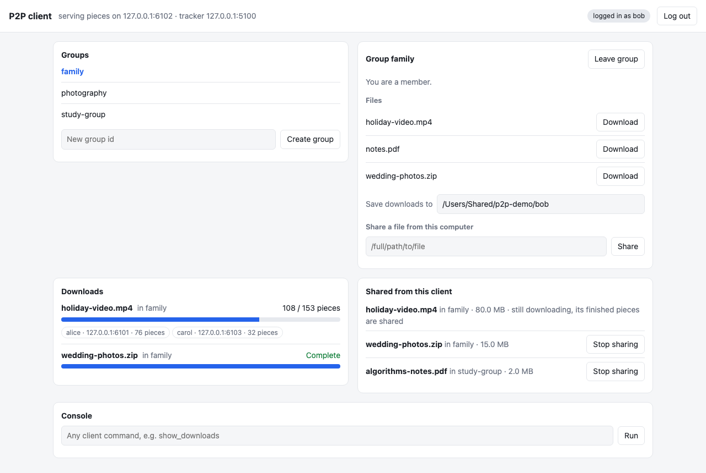
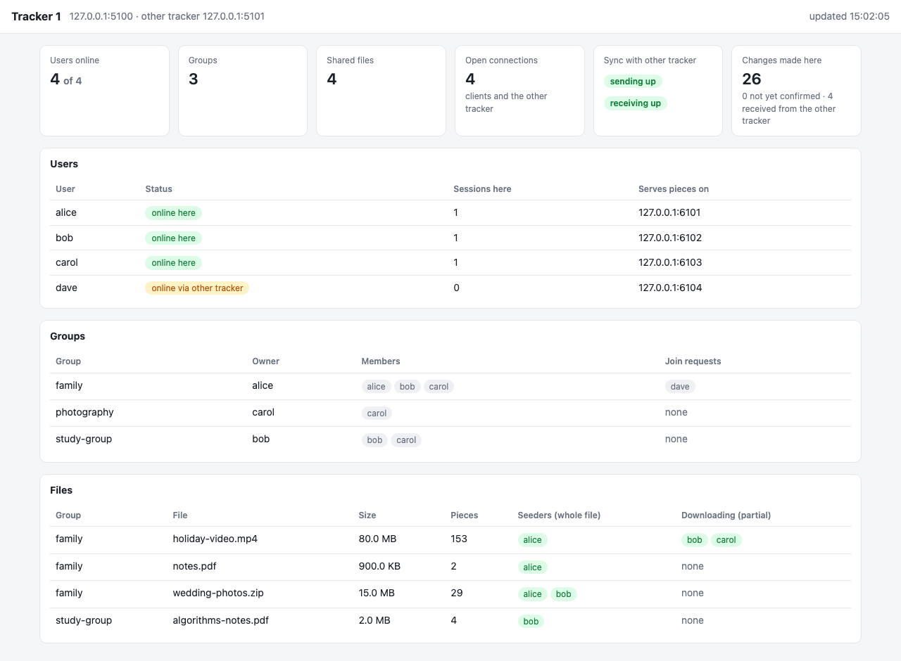

# P2P File Sharing System

A peer-to-peer file sharing system with two synchronized trackers. Users form groups and share files inside them. Files never pass through a tracker. They are split into 512 KB pieces, verified with SHA-1, and downloaded in parallel from every client that has them, including clients that are still downloading.

Each client can also serve a web UI and each tracker a live dashboard; see [Web interfaces](#web-interfaces) for screenshots.

## Contents
1. [Directory structure](#directory-structure)
2. [Building](#building)
3. [Running](#running)
4. [Web interfaces](#web-interfaces)
5. [Architecture](#architecture)
6. [Key algorithms](#key-algorithms)
7. [Data structures](#data-structures)
8. [Network protocol](#network-protocol)
9. [Files on disk](#files-on-disk)
10. [Assumptions](#assumptions)
11. [Features](#features)
12. [Testing](#testing)

---

## Directory structure
```
2025201053_A3/
├── client/
│   ├── client.cpp       # client: shell, downloads, peer server, heartbeats, web UI server
│   ├── webui.h          # the client's web page (HTML, CSS, JavaScript)
│   └── Makefile
├── tracker/
│   ├── tracker.cpp      # tracker: users, groups, file metadata, sync, state file, dashboard server
│   ├── dashboard.h      # the tracker's dashboard page (HTML, CSS, JavaScript)
│   └── Makefile
├── docs/                # screenshots of the web UI and the dashboard (light and dark)
├── tests/
│   ├── run_tests.sh     # automated end-to-end tests
│   └── p2pmsg.cpp       # test tool: sends protocol messages, prints replies
├── tracker_info.txt     # addresses of the two trackers
├── README.md            # this file
└── Report.md            # design report
```

## Building
### Dependencies
- A C++17 compiler (`g++`) and `make`
- POSIX sockets and threads
- OpenSSL: SHA-1 for file pieces (client); salted password hashing and random session tokens (tracker)
- `curl`, only for `tests/run_tests.sh`

Ubuntu/Debian:
```bash
sudo apt-get update
sudo apt-get install g++ make libssl-dev
```

macOS: install the Xcode Command Line Tools and OpenSSL from [Homebrew](https://brew.sh). Both Makefiles find Homebrew's OpenSSL automatically.
```bash
xcode-select --install
brew install openssl@3
```

### Compile
```bash
cd tracker && make      # produces tracker/tracker
cd ../client && make    # produces client/client
```
`make clean` removes the binary in each folder. `tests/run_tests.sh` builds everything itself.

---

## Running
### 1. Tracker info file
One line per tracker, `<IP> <PORT>`. Line 1 is tracker 1, line 2 is tracker 2:
```
127.0.0.1 5000
127.0.0.1 5001
```

### 2. Trackers
```bash
./tracker tracker_info.txt 1 [web_port]
./tracker tracker_info.txt 2 [web_port]
```
- **Dashboard.** With a `web_port`, the tracker also serves a read-only dashboard at `http://127.0.0.1:<web_port>/` (see [Web interfaces](#web-interfaces)).
- **State file.** Each tracker keeps its state in `tracker<N>.state` in its working directory. A restarted tracker carries on from there.
- **Stopping.** Type `quit` in a tracker's console to stop it.
- **Shared secret.** The two trackers authenticate each other with a shared secret. It defaults to a built-in value; to choose your own, export the same value for both trackers before starting them:
  ```bash
  export TRACKER_SECRET=some-long-random-string
  ```

### 3. Clients
```bash
./client <IP>:<PORT> tracker_info.txt [web_port]
```
`<IP>:<PORT>` is where this client serves pieces to other clients, for example `./client 127.0.0.1:6000 tracker_info.txt`. With a `web_port`, the client also serves a web UI and prints its link at startup, for example `Web UI: http://127.0.0.1:8000/?t=3f9a…`. In its working directory the client writes:
- `cl.log`, a log of its downloads;
- `p2p_client_<PORT>.state`, its shared files and unfinished downloads, per user;
- `<destination>.part` next to each unfinished download.

### 4. Client commands
| Command | Effect |
|---|---|
| `create_user <user_id> <password>` | Register a new user |
| `login <user_id> <password>` | Start a session. Also shares this user's files again and resumes their unfinished downloads |
| `create_group <group_id>` | Create a group; you become its owner |
| `join_group <group_id>` | Ask to join a group |
| `leave_group <group_id>` | Leave a group and stop sharing your files in it. If the last member leaves, the group and its files are deleted |
| `list_groups` | All groups |
| `list_requests <group_id>` | Pending join requests (owner only) |
| `accept_request <group_id> <user_id>` | Accept a join request (owner only) |
| `upload_file <group_id> <file_path>` | Share a file with a group |
| `list_files <group_id>` | Files shared in a group |
| `download_file <group_id> <file_name> <destination>` | Download in the background. `<destination>` is a file path or an existing directory. Run it again to resume a paused download |
| `show_downloads` | `[D] gid file done/total` while downloading, `[C] gid file` when complete, `[E] gid file reason` if failed or paused |
| `stop_share <group_id> <file_name>` | Stop sharing one file |
| `logout` | End the session and stop serving pieces |

---

## Web interfaces
Both are optional, need no extra software, and are served by the programs themselves: a small HTTP/1.1 server written with plain sockets, and pages in plain HTML, CSS and JavaScript with no external files. Both follow the system's light or dark setting.

### Client web UI (`./client … <web_port>`)
<picture>
  <source media="(prefers-color-scheme: dark)" srcset="docs/client-web-ui-dark.png">
  
</picture>

*Bob's client during a download. `holiday-video.mp4` is arriving from Alice, who has the whole file, and from Carol, who is still downloading it herself (partial seeding). Bob already shares the pieces he has.*

Open the link the client prints. In the browser you can:
- log in, or create an account;
- create, join and leave groups, and see a group's files and (as owner) its join requests;
- share a file by its path on this computer, and download a group's files to a folder;
- watch downloads live: a progress bar per file, and for each peer how many pieces it delivered, whether it has the whole file, and whether it was dropped for sending bad data;
- see what this client shares, including pieces of unfinished downloads, and stop sharing;
- type any client command in a console, exactly as in the terminal.

Every action runs through the same code as the terminal shell (`run_command`), so the two always behave the same, and the terminal stays usable alongside. Adding `#<group>` to the link opens that group directly.

**Security.** The page can run any command, including sharing files from this computer, so:
- it listens only on `127.0.0.1` and can't be reached from other machines;
- every API call must carry the random token from the printed link (in an `X-P2P-Token` header), so other websites open in the same browser can't send it commands;
- every name shown (users, groups, files) is HTML-escaped, so a file named like a script can't take over the page.

| Request | Answer |
|---|---|
| `GET /` | the page |
| `GET /api/state` | JSON: login, downloads with per-peer progress, shared files, groups |
| `GET /api/group?g=<group>` | JSON: membership, files, and join requests if you are the owner |
| `POST /api/cmd` (body: one command line) | JSON: what the command printed |

### Tracker dashboard (`./tracker … <web_port>`)
<picture>
  <source media="(prefers-color-scheme: dark)" srcset="docs/tracker-dashboard-dark.png">
  
</picture>

*Tracker 1 at the same moment. Dave is logged in through tracker 2, so he shows as "online via other tracker". His request to join `family` is pending, and Bob and Carol appear as partial downloaders of the video.*

A read-only page at `http://127.0.0.1:<web_port>/`, refreshed every second. It shows:
- users and whether each is online here, online through the other tracker, or offline;
- groups with their owners, members and join requests;
- every file with its size, piece count, full seeders, and clients still downloading it;
- the sync link: whether sending and receiving are up, how many changes were made here, how many the other tracker hasn't confirmed yet, and how many were received from it;
- the number of open connections.

It also listens only on `127.0.0.1`, since it shows user names and addresses. Its data comes from `GET /api/state` as JSON.

---

## Architecture
```
            ┌──────────── sync link (both directions) ────────────┐
            ▼                                                       ▼
      ┌───────────┐                                           ┌───────────┐
      │ Tracker 1 │                                           │ Tracker 2 │
      └───────────┘                                           └───────────┘
        ▲      ▲   commands, heartbeats (client prefers           ▲
        │      │   tracker 1, fails over to tracker 2)             │
   ┌────┴───┐ ┌┴───────┐                                     ┌─────┴──┐
   │Client A│ │Client B│◄── BITFIELD / GETPIECE / pieces ───►│Client C│
   └────────┘ └────────┘                                     └────────┘
```
- **Trackers** keep the metadata: users, sessions, groups, join requests, and for every shared file its size, its SHA-1 hashes, and who has it. They never handle file data.
- **Clients** act as both downloaders and seeders. A client serves every piece it has verified, including pieces of files it is still downloading.
- **Either tracker** can serve any client. Every change made on one tracker is applied on the other, and both survive restarts.

### Threads
| Process | Thread | Job |
|---|---|---|
| Tracker | main | console (`quit`) |
| | server | **event loop**: one `poll()` over every connection; hands whole messages to the workers |
| | 8 workers | handle requests. A connection costs no thread: 300 extra idle connections left the tracker at 11 threads |
| | `sync_sender` | sends this tracker's changes to the other tracker |
| | dashboard (optional) | accepts dashboard requests, one short-lived thread per request |
| Client | main | command shell |
| | `peer_server` | accepts peer connections, one thread per connected downloader |
| | `heartbeat` | pings the tracker every 5 s, fails over if it is down |
| | per download | one coordinator, plus one worker per peer it downloads from |
| | web UI (optional) | accepts browser requests, one short-lived thread per request |

---

## Key algorithms
### Pieces and integrity
- A file is split into 512 KB pieces; the last piece may be shorter.
- On upload, the client reads the file once and computes both the SHA-1 of every piece and the SHA-1 of the whole file. These hashes go to the tracker, and every downloader receives them.
- Each piece is checked against its hash as soon as it arrives. A corrupt piece is discarded, and the peer that sent it is dropped for the rest of the download (see peer scoring).
- When every piece is in, the whole file's hash is checked. Only then is the download marked `[C]` and the client registered as a full seeder.

### Partial seeding
- When a download starts, the client registers with the tracker as a *partial peer* for that file (`start_download`).
- From then on it serves every piece it has verified. Other downloaders ask a partial peer which pieces it has with `BITFIELD`, and ask again every second while they have nothing left to fetch from it.
- **Effect on the original seeder's load.** In tests, A seeded a 77-piece file and B and C downloaded it at overlapping times. A uploaded 106–116 pieces instead of 154 (2 × 77), because B and C fetched the rest from each other.

### Piece selection: rarest first, then endgame
- **One worker per peer.** For every peer that has the file, a worker keeps one connection open and asks a shared *piece picker* what to request next.
- **Rarest first.** The picker chooses, among pieces that the peer has and we still need, the one held by the fewest usable peers, breaking ties at random. Rare pieces get copied first, so a file stays complete across the group even if its original seeder leaves.
- **No duplicate requests normally.** A piece already requested from one peer isn't requested from another.
- **Endgame.** Once every missing piece has been requested somewhere, the picker allows a second request to a different peer, so one slow peer can't hold up the end of the download. Whichever copy arrives first is used.
- **Load balances itself.** Because each worker pulls its next piece as soon as it has a free slot, faster peers deliver more pieces. With 2 equal seeders, a 1,908-piece file split 952 / 956.

### Persistent connections and pipelining
- Each worker keeps one TCP connection per peer for the whole download, with up to 4 `GETPIECE` requests outstanding at a time, so the peer never waits for the next request.
- The seeder answers with `sendfile()`: piece data goes from the page cache to the socket without being copied through the program. Seeder memory stayed around 5 MB while serving a 1 GB file.

### Peer scoring
| Peer behaviour | Result |
|---|---|
| Sends a piece that fails its hash | **banned** for the rest of this download |
| Can't be reached or stops answering (3 s connect, 10 s reply) | its worker stops; reconnect after 2, 4, 8 … 30 s |
| Answers "not sharing" (logged out) or loses the file | its worker stops; reconnect after a backoff |
| Works well | gets more requests, because its worker asks for more pieces as it finishes them |

### Refresh, pause and resume
- **Refresh.** Every 5 s the coordinator asks the tracker for the current peer list, so new peers, and peers that have just finished their copy, are used.
- **Pause.** If no new piece arrives for 30 s, the download pauses. Its status becomes `[E] … paused at k/n pieces`, and the pieces it already has stay shared.
- **Progress saved.** `<destination>.part` records which pieces are done, and is rewritten every 16 pieces.
- **Resume.** After a crash, restart or pause, the download resumes:
  - automatically at the next `login` of that user, or
  - when `download_file` is run again with the same destination.

  Pieces marked done in the `.part` file are hashed again before they are trusted. In a test, a client killed 2.5 s into a download resumed with 32 of 77 pieces already done.
- **Re-sharing.** At login, the user's shared files are offered to the tracker again from `p2p_client_<PORT>.state`, unless the file is gone or has changed size. A restarted client therefore keeps seeding.

### Tracker synchronization
Both trackers accept changes from clients and send them to each other:
- **One ordered stream per direction.** A single lock (`mstate`) guards all tracker state. A change is applied, appended to the `outbox` and written to the state file under that lock, so all three follow the same order. The `sync_sender` thread keeps one connection to the other tracker and sends outbox entries one at a time as `OP <seq> <change>`. Each one is removed only after the other tracker answers `ACK <seq>`.
- **Changes, not commands.** What is sent is the change to apply, such as `create_user u <salt> <hash> <origin>` or `join_group g u`. The receiver applies it with the same `apply_op` function the sender used. `apply_op` ignores changes that no longer fit, so applying one twice is harmless.
- **Epochs.** Each tracker's state has a random id. The id lives in the state file, so it survives restarts. The receiver remembers which state it is applying changes from and the last sequence number it applied. Each link opens with `SYNC_HELLO <secret> <epoch>`, and the receiver answers in one of two ways:
  - `RESUME n`: the sender continues from change `n+1`. This covers a dropped link, a frozen tracker (Ctrl+Z), or a tracker restarted from its state file. Unconfirmed changes are kept in the outbox, in memory and on disk, so nothing is lost.
  - `NEW`: the receiver has never seen this state. The sender either sends its outbox from change 1 (if it still holds every change, and all its other data came from the receiver) or first sends a full `SNAPSHOT`.
- **Startup.** A tracker starts from its state file if it has one. If not, it copies the other tracker's whole state (`SNAPSHOT_REQ`) before accepting any clients.
- **Conflicts.** If the two trackers were cut off from each other and both created the same user name, group id or file name with different content, the version created through tracker 1 wins, on both trackers:
  - a group's other creator stays a member;
  - copies of the losing file version are dropped.
- **Liveness.** The sender sends `PING` when idle for 2 s. If either side hears nothing for 5–8 s, it drops the link and reconnects.

### Sessions, passwords and who counts as online
- **Passwords** are stored only as a salted PBKDF2-HMAC-SHA256 hash (20,000 rounds). The state files never contain a password.
- **Session tokens.** A successful `login` returns a random session token. If a client's connection breaks, or it fails over to the other tracker, it continues the session with `resume <user> <token>`, so the password is never sent again. Trackers store and sync only a hash of each token. `logout` revokes the token on both trackers.
- **Online on this tracker:** a user has at least one logged-in connection. A connection's session ends on `logout`, on disconnect, or after 15 s without a heartbeat. The 15 s rule applies from login onward.
- **Online through the other tracker:** trackers send each other `online` and `offline` changes, plus a full `PRESENCE` list whenever the link (re)connects. When the link drops, these logins stay trusted for 20 s. That tracker's clients fail over within about 5 s through heartbeats, and clients that died with it expire.

### Failure handling summary
| Failure | Detected by | Result |
|---|---|---|
| Tracker dies | client heartbeat (≤5 s) or a failed command | client reconnects to the other tracker and resumes its session with its token |
| Tracker frozen or cut off | 10 s reply timeout | same as above; the frozen tracker catches up when it returns |
| Tracker restarts | — | loads its state file and continues its sync stream |
| Tracker loses its state file | no state file at startup | copies the other tracker's state |
| Both trackers restart | — | both load their state files; clients resume their sessions |
| Client dies | TCP disconnect | its session ends; it stops being listed as a peer |
| Client frozen or cut off | no heartbeat for 15 s | same as above; listed again once it resumes |
| Client restarts | — | login re-shares its files and resumes its downloads |
| Seeder dies or stalls mid-download | 3 s connect / 10 s reply timeout | piece fetched from another peer; reconnect later with backoff |
| Peer sends a corrupted piece | SHA-1 mismatch | piece discarded; peer banned for this download |
| No peer has the missing pieces | 30 s without progress | download pauses and resumes later |
| Malformed message | header length check, field validation | error reply or connection closed; the process keeps running |

---

## Data structures
### Tracker
All guarded by one mutex, `mstate`. Commands are short, and one lock keeps the sync stream and the state file in the same order as the changes.

| Structure | Purpose | Why |
|---|---|---|
| `map<string,userdetails> login` | user → salt, password hash, token hashes, peer address, `sessions`, `remote`, `origin` | ordered map: O(log n) lookup, stable snapshot order |
| `map<string,group> groups` | group → owner, `grpmem` (owner always first), `req`, `origin` | small vectors; order gives a deterministic next owner |
| `map<string,map<string,fileinfo>> group_files` | group → file name → size, file hash, piece hashes, `seeders`, `leechers`, `origin` | file names are unique per group, so lookup by (group, name) is direct |
| `deque<pair<seq,change>> outbox` | changes not yet confirmed by the other tracker | append at the back, remove from the front on each ACK |
| `map<int,shared_ptr<Conn>>` (event loop) | per connection: unread bytes, user, token, flags | only the poll thread touches the map; a connection being handled is lent to one worker |

### Client
| Structure | Purpose |
|---|---|
| `map<string,ShareInfo> sharedFiles` | `gid:fname` → path, size and hashes. For a download in progress it also points at the download, so only verified pieces are served |
| `DownloadState` | per download: `have`, `inflight` and `avail` per piece, the peers (`PeerInfo`: bitfield, complete, banned, backoff, pieces delivered), the `.part` saver |
| `map<string,string> downloads` | `gid:fname` → status line for `show_downloads` |
| `map<string,string> persisted` | lines of `p2p_client_<PORT>.state` |

---

## Network protocol
All communication uses TCP.

### Message format
Every message on every connection is:
```
[ type: 1 byte ][ status: 1 byte ][ payload length: 4 bytes, network byte order ][ payload ]
```
| Type | Meaning | Payload |
|---|---|---|
| 1 | request | text command (status 0) |
| 2 | reply | text (status = result code) |
| 3 | piece data | raw piece bytes (status 0) |

The receiver reads exactly 6 bytes, then exactly that many payload bytes, looping over `recv`. Senders loop over `send`. Partial transmissions are therefore handled on both sides. Messages over 64 MB (4 KB for requests to a peer) are rejected and the connection is closed.

### Status codes
| Code | Meaning |
|---|---|
| 0 | OK |
| 1 | bad request: malformed message or wrong arguments |
| 2 | not logged in |
| 3 | authentication failed, or session expired |
| 4 | already exists |
| 5 | not found |
| 6 | forbidden: not a member, not the owner, or wrong sync secret |
| 7 | conflict: a different file with this name is already shared |
| 8 | unavailable: the peer isn't sharing right now |
| 9 | unknown command |

### Client → tracker
| Request | Reply text on success (code 0) | Other codes |
|---|---|---|
| `create_user <u> <p>` | `user created successfully` | 4 |
| `login <u> <p> <peer_ip> <peer_port>` | `<token> user login successfull` | 3 |
| `resume <u> <token> <peer_ip> <peer_port>` | `session resumed` | 3 |
| `heartbeat` | `alive` | 2 |
| `create_group <g>` | `group created successfully` | 2, 4 |
| `join_group <g>` | `join request to the group is sent` | 2, 4, 5 |
| `leave_group <g>` | `user removed from the group …` | 2, 5, 6 |
| `list_groups` | `<g1> <g2> …` or `no groups` | |
| `list_requests <g>` | `<u1> <u2> …` or `no pending requests` | 2, 5, 6 |
| `accept_request <g> <u>` | `user added to group` | 2, 5, 6 |
| `upload_file <g> <name> <size> <filehash> <n> <hash_1> … <hash_n> <uid> <peer_ip> <peer_port>` | `file uploaded!` | 1, 2, 5, 6, 7 |
| `start_download <g> <name>` | `download registered` | 2, 5, 6 |
| `list_files <g>` | `<f1> <f2> …` or `No files in the group` | 2, 5, 6 |
| `download_file <g> <name>` | `<size> <filehash> <n> <hash_1> … <hash_n> PEERS <uid> <ip> <port> <C\|P> …` | 2, 5, 6 |
| `stop_share <g> <name>` | `sharing this file is stopped` | 2, 5, 6 |
| `logout` | `logout successfull` | 2 |

In `download_file` replies, `C` marks a peer with the whole file and `P` a peer still downloading. Only peers online right now are listed. The tracker ignores the `<uid>` field of `upload_file` and records the user logged in on that connection.

### Client → client
A downloader keeps one connection per peer and may have several requests outstanding. Replies come back in request order.

| Request | Replies |
|---|---|
| `BITFIELD <g> <name>` | `0` + one `1`/`0` per piece: the pieces this peer can serve now |
| `GETPIECE <g> <name> <index>` | type 3 with the piece bytes, or `1 bad request`, `5 file not shared here`, `5 no such piece` (out of range, or not downloaded yet), `8 not sharing while logged out` |

### Tracker → tracker
| Message | Reply | Purpose |
|---|---|---|
| `SNAPSHOT_REQ <secret>` | `0 SNAPSHOT <epoch> <seq>` + one change per line | a tracker without a state file copies the full state |
| `SYNC_HELLO <secret> <epoch>` | `0 RESUME <n> <epoch>` or `0 NEW 0 <epoch>` | opens the change stream |
| `SNAPSHOT <epoch> <seq>` + changes | `0 ACK <seq>` | full state, sent when the receiver may be missing data |
| `PRESENCE <u> <ip> <port> …` | `0 OK` | users with a session on the sender right now |
| `OP <seq> <change>` | `0 ACK <seq>` | one change |
| `PING` | `0 PONG` | keeps the link alive |

The changes are:
- `create_user u salt hash origin`
- `add_token u tokenhash` / `revoke_token u tokenhash`
- `online u ip port` / `offline u`
- `create_group g owner origin`
- `join_group g u`, `accept_request g u`, `leave_group g u`
- `upload_file …` (as above, plus `origin`)
- `leech g name u ip port`
- `stop_share g name u`

Snapshots also use `add_member`, `file_meta` and `seeder`.

### Timeouts
| What | Value |
|---|---|
| connect (tracker or peer) | 3 s |
| waiting for a tracker or peer reply | 10 s |
| client heartbeat interval | 5 s |
| tracker drops a silent logged-in client | 15 s |
| seeder drops a silent downloader connection | 30 s |
| sync ping interval / link considered dead | 2 s / 5–8 s |
| trust in "online through the other tracker" after the link drops | 20 s |
| peer list refresh during a download | 5 s |
| download pauses after no progress for | 30 s |
| reconnect backoff for a failing peer | 2, 4, 8 … 30 s |

---

## Files on disk
| File | Written by | Contents |
|---|---|---|
| `tracker<N>.state` | tracker | A checkpoint, then one line per change since. `C` lines are the state as changes, `O` lines this tracker's unconfirmed changes at checkpoint time, `L` changes made here since, `R` changes from the other tracker, `A` confirmations, `E`/`P`/`F` sync bookkeeping. Rewritten as a single checkpoint at startup and every 20,000 lines. Mode 0600 |
| `p2p_client_<PORT>.state` | client | `share <user> <gid> <name> <size> <filehash> <n> <hashes…> <path>` and `download <user> <gid> <name> <dest>` |
| `<dest>.part` | client | `P2PPART <filehash> <size>`, then one `1`/`0` per piece |
| `cl.log` | client | download log: pieces and the peer each came from, retries, bans, a per-peer summary |

---

## Assumptions
- User ids, passwords, group ids, file names and paths contain no whitespace.
- Within a group, a file name identifies one file. Uploading different content under an existing name is rejected (code 7).
- Every client's `<IP>:<PORT>` is reachable by the other clients.
- Both trackers use the same `tracker_info.txt` and the same `TRACKER_SECRET`.
- There are exactly one or two trackers.
- A client keeps a shared file at its path, unchanged, while sharing it.
- Each client runs from its own working directory (its state, log and `.part` files live there).

## Features
- **The specification:** every command, with the status format `[C] [group_id] filename`.
- **Pieces and integrity:** 512 KB pieces, with SHA-1 per piece and per file.
- **Downloading:**
  - parallel downloads, several files at once;
  - partial seeding;
  - rarest-first piece selection with an endgame mode;
  - one persistent, pipelined connection per peer;
  - `sendfile()` on the seeder;
  - peer scoring, with bans and backoff;
  - peer list refresh during a download;
  - downloads pause and resume through `.part` files.
- **Sharing:** a restarted client shares its files again; a completed download becomes a full seeder.
- **Trackers:**
  - consistent through an ordered, acknowledged change stream;
  - state survives restarts of either or both trackers;
  - catch-up after a link drop or freeze;
  - full copy for a tracker that lost its state;
  - deterministic conflict resolution;
  - authenticated sync messages.
- **Tracker event loop:** a fixed pool of 8 workers, so idle connections cost no threads.
- **Security:** salted, slow password hashes; session tokens instead of resending passwords.
- **Liveness:**
  - clients fail over between trackers automatically, even while idle;
  - crashed, frozen or logged-out clients are not offered as peers;
  - timeouts on every network wait.
- **Protocol:** a binary header with type, status and length, so partial reads and writes and malformed input are handled.
- **Web interfaces:** an optional browser UI for each client, and an optional live dashboard for each tracker.

---

## Testing
### Automated
```bash
tests/run_tests.sh              # everything, about 100 s
tests/run_tests.sh liveness     # one section: basic swarm restart trackers liveness misc web
KEEP=1 tests/run_tests.sh       # keep logs and state files for inspection
```
The script builds everything, then starts real trackers and clients on random local ports, drives them, breaks things on purpose, and prints `PASS` or `FAIL` per check. It exits with the number of failures. `tests/p2pmsg` sends raw protocol messages, for checks that the client shell can't make.

| Section | What it checks |
|---|---|
| `basic` | concurrent downloads of a 300 KB and a 12 MB file; identical results; multi-peer download; status codes; same-name conflict; malformed messages to tracker and seeder |
| `swarm` | partial seeding (C downloads from B while B is still downloading); fewer uploads from the original seeder; a corrupting peer is banned and the download still finishes correctly |
| `restart` | a killed download leaves a `.part` file and resumes at the next login, keeping its pieces; a restarted seeder re-shares its files |
| `trackers` | heartbeat failover while idle; downloads through tracker 2; both trackers restart from disk; sessions continue with tokens; a frozen tracker catches up, deletions included; a tracker without a state file copies the other; conflicting sign-ups converge to tracker 1's version |
| `liveness` | a frozen client is dropped after 15 s and listed again on resume; a download finishes despite a frozen seeder; a crashed client disappears at once |
| `misc` | no plaintext passwords in state files; passwords work on both trackers; the sync secret is required; 300 idle connections add no tracker threads |
| `web` | the client serves its page; the API refuses calls without the token; commands run through the API as in the terminal; the dashboard shows the logged-in user online |

All 50 checks pass on macOS 26.6 (Apple M5).

### Manual
1. Start both trackers and three clients (`a`, `b`, `c`) as above. Create users and a group, and have `b` and `c` join.
2. `a` uploads files of different sizes and types (text, binary, image, archive, up to 1 GB). `b` and `c` download them. Compare with `cmp original copy`, and look in `cl.log` to see which peer each piece came from.
3. Kill (`Ctrl+C`) or freeze (`Ctrl+Z`, then `fg`) a tracker, a seeder or a downloader mid-transfer, and check the results against the [failure handling table](#failure-handling-summary).
